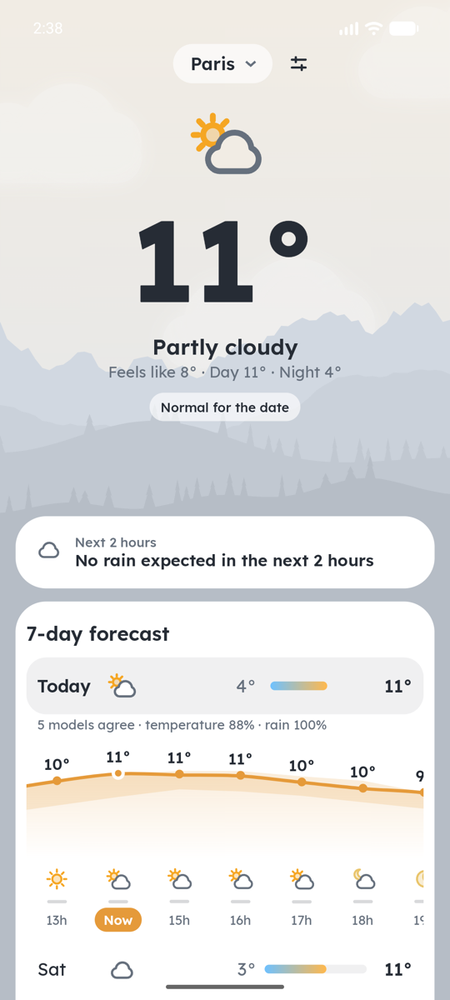
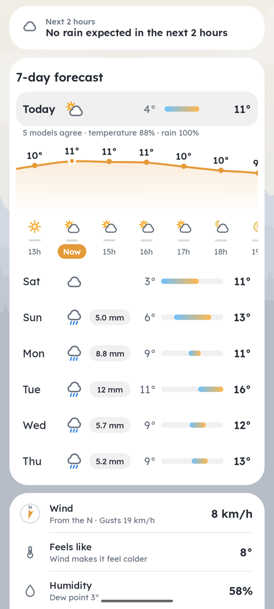
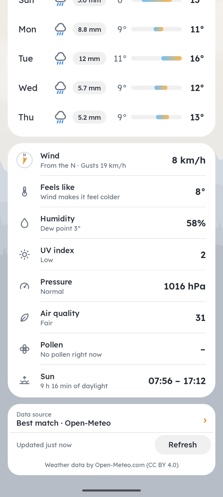
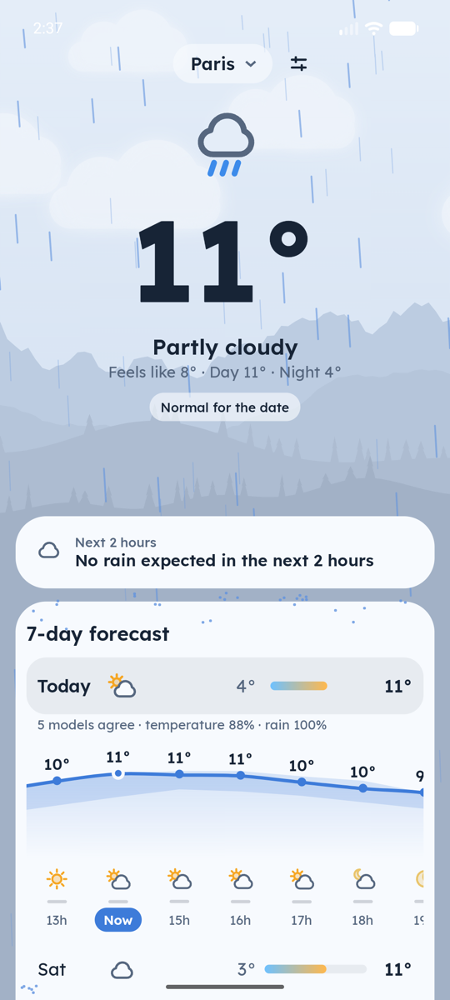
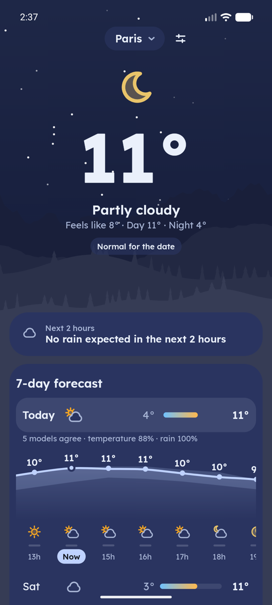

# Météo

A weather app for Android, written in Rust with a [Slint](https://slint.dev) UI.
Forecasts come from [Open-Meteo](https://open-meteo.com) (free, no API key).

<p>
  
  
  
  
  
</p>

```
core/        meteo-core: Open-Meteo client, models, weather codes → icons/colours,
             chart geometry, cache, saved cities, and the view models for the
             main screen and the widgets. No UI code.
app/         meteo: the Slint app (ui/main.slint) + glue in src/lib.rs.
widget-ffi/  JNI functions for the Android widget (libmeteo_widget.so, no UI code).
android/     Gradle project: packages the Rust libraries + the Kotlin Glance widget.
docs/        screenshots, privacy policy, Play Store notes and icon.
vendor/      Slint 1.18.1 core and Skia renderer with small fixes (see Notes).
scripts/     gen-widget-icons.py: the widget's icons from the app's drawn icons.
```

The UI only binds ready-to-display values from `MainScreen`; formatting and layout
maths stay in `core` so the home-screen widget (Kotlin) can reuse them.

## Desktop preview

For working on the UI without a phone, the same Slint app runs in a desktop window:

```bash
cargo run -p meteo
METEO_WEATHER=storm cargo run -p meteo   # force a weather for the animations
```

It's a development tool, not a desktop app: "Use my location" and the widget are
Android only, and it keeps its data in `~/.cache/meteo`.

## Run on Android

One-time setup: the Android SDK with NDK `30.0.16248370`, JDK 17 or newer, the Rust
target, and `cargo-ndk`.

```bash
rustup target add aarch64-linux-android
cargo install cargo-ndk
```

Build and install (emulator or device connected via `adb`):

```bash
cd android
./gradlew installDebug
```

Gradle's `cargoBuild` task runs `cargo ndk` first, building `libmeteo.so` (the Slint app,
started by `android.app.NativeActivity`) and `libmeteo_widget.so` (the widget's bridge).
`./gradlew assembleRelease` builds optimised Rust.

## Android widget

A home-screen widget showing the selected city: icon, temperature, condition, high/low,
and in its wide size the next 5 hours on a card. Tapping it opens the app. It uses the
app's weather palette (background, text) and the same drawn icons. Glance can't draw
Slint, so `scripts/gen-widget-icons.py` writes the icons as Android vector drawables
(`res/drawable/wx_*`, a light and a dark variant each) from the same shapes as
`app/ui/icons.slint`.

- The layout is Kotlin Glance ([MeteoWidget.kt](android/app/src/main/java/dev/meteo/app/widget/MeteoWidget.kt)).
  Its content comes from Rust: `RustBridge.state()` returns `meteo_core::WidgetState` as
  JSON, built from `places.json` and the city's cached forecast and moved forward to the
  current hour.
- If the cache is missing or older than 30 minutes, the widget calls `RustBridge.refresh()`,
  which downloads the forecast in Rust while the app is closed. Android also wakes the
  widget every 30 minutes.
- After every download, the app tells the widget to redraw (`notify_widgets`, a JNI
  broadcast), so switching city in the app updates the widget straight away.

Two more widgets share the same Rust state:

- **Météo · Rain** (3×2): the next two hours of rain, a sentence ("Rain in 30 min") and
  eight quarter-hour bars.
- **Météo · Round** (1×1): the icon and temperature in a circle.

## Notifications

Two optional notifications, switched on in the settings (Android asks for permission the
first time):

- **Morning summary:** once a day between 7 and 10 am: condition, day and night
  temperatures, rain expected.
- **Rain alert:** when rain should start within the hour, at most once every 3 hours.

`MeteoApp.kt` schedules a WorkManager job every 15 minutes. `NotifyWorker` refreshes the
forecast and asks Rust what to post (`meteo_core::notify::due`). What was already sent is
kept in `notify-state.json`, so nothing repeats.

## Tests

```bash
cargo test -p meteo-core                    # offline tests
cargo test -p meteo-core -- --include-ignored  # also hits the live API
```

GitHub Actions (`.github/workflows/ci.yml`) runs on every push and pull request:
`cargo fmt --check`, clippy with warnings as errors, the tests, and an Android
release build (debug-signed, kept as the `meteo-apk` artifact).

## Days hour by hour

The main screen shows the current weather and the 7-day list. Tap a day to open it
hour by hour, in a chart that scrolls sideways:

- the temperature curve, with each hour's temperature
- the weather icon and the chance of rain
- the expected rain as a bar with its amount in mm. Bars share one scale for the whole
  week (at least 2 mm), so a wet day looks wetter than a drizzly one.

Today is open when the app starts, at the current hour marked "Now"; other days open
in the morning. Each
day row also shows the day's total rain. Amounts are Open-Meteo's `precipitation`:
rain, showers and snow as water, in mm.

All of it is computed in `core` (`DayView` and `DayHourView` in
[core/src/view.rs](core/src/view.rs), including the curve's geometry). The `DayChart`
component in `main.slint` only draws it.

## Data source

Tap "Data: … ›" at the bottom of the screen to pick the weather model.
[core/src/source.rs](core/src/source.rs) lists them: Best match (Open-Meteo's default
blend), Météo-France (AROME/ARPEGE), ECMWF, DWD ICON, NOAA GFS, UK Met Office,
MET Norway, KNMI, DMI, Environment Canada and JMA. They all come through Open-Meteo,
so there are still no API keys.

- Regional models are more detailed near home but may cover fewer days (Météo-France:
  about 4) or have no rain probability (Météo-France, JMA). Parsing stops at the first
  missing hour or day instead of failing.
- The choice is saved in `settings.json`, and the widget uses it too. Each source has
  its own cache file (`forecast-<lat>_<lon>-<model>.json`), so switching back and
  forth works offline.

## Animated weather

Behind the forecast, the sky moves with the current weather: rain, snow, drifting
clouds, fog, twinkling stars at night, and lightning in storms.

- [core/src/scene.rs](core/src/scene.rs) is a small particle simulation. Raindrops
  fall under gravity with air drag up to a terminal speed that depends on their size,
  and are pushed sideways by the forecast's wind, direction included. Snowflakes
  sway as they fall. Clouds drift with parallax (bigger ones are closer and move
  faster). Lightning is a flash, a quick second flicker and a random pause.
- Each particle layer reaches Slint as one path string per frame, so hundreds of
  drops are drawn with a single element. The rest is
  [app/src/animation.rs](app/src/animation.rs) (a timer) and the `Sky` component in
  `main.slint`.
- **Rain follows the forecast:** the number of drops and their size follow the current
  mm per hour, and drops that land on a card splash on its top edge (the UI passes the
  cards' positions to the simulation each frame).
- It runs at 60 fps when something falls and 30 fps for clouds, fog and stars. It
  pauses behind the city picker and the settings, and stops entirely while the app
  is in the background.

To see a given weather whatever the forecast says:

```bash
METEO_WEATHER=storm cargo run -p meteo   # clear, night, partly, cloudy, fog, drizzle, rain, snow, storm
```

## Look

The whole UI takes the colours of the weather: warm amber on a clear afternoon, peach at
dawn and dusk, cool blue-white in the rain, grey in fog, deep charcoal in a storm, and deep
blue at night. Inspired by Gradient Weather.

- **Palettes** ([core/src/palette.rs](core/src/palette.rs)): one for each condition and
  time of day. Each gives the background gradient, the cards, the text, the accent (curve,
  "Now", buttons), the rain and snow streaks, and the clouds.
- **Hero:** centred, with a city pill, a line-drawn weather icon, a large bold
  temperature, the condition, and "Feels like · Day · Night". Cards float on the
  gradient.
- **Weather icons** ([app/ui/icons.slint](app/ui/icons.slint)): our own line icons drawn
  as paths in one consistent style: sun, moon, partly cloudy (day and night), cloud,
  fog, drizzle, rain, snow and storm. Core picks which one to draw (`icon_kind`).
- **Font:** [Lexend](https://github.com/googlefonts/lexend), a rounded sans-serif,
  embedded in the app (`app/ui/fonts/`, SIL Open Font License in `OFL.txt`). The widgets
  use the phone's font.
- **Landscape** ([core/src/landscape.rs](core/src/landscape.rs)): mountains, hills and
  pines (each city its own skyline), drawn tone-on-tone in the palette's colours at the
  bottom of the hero. Clouds pass behind them; rain and snow fall in front.

When the city, the weather or the time of day changes, every colour fades to the
new one (0.8 s): the sky, the hills, the cards and the text.

To preview a weather or time of day: `METEO_WEATHER=snow METEO_TIME=dusk cargo run -p meteo`
on the desktop, or on Android `adb shell setprop debug.meteo.weather snow` and
`adb shell setprop debug.meteo.time dusk`, then restart the app.

## Details

One list, a line each, with a line icon, a short explanation and the value:

- **Wind:** speed, where it comes from, and gusts. Its icon is a small compass whose
  arrow points where the wind blows; on a phone the dial turns with the phone
  (rotation vector sensor), so its N points north. The sensor is off while the app
  is in the background.
- **Feels like:** with why it differs, for example wind chill.
- **Humidity:** with the dew point.
- **UV index** and its level.
- **Pressure:** in hPa, with low (unsettled) or high (settled).
- **Air quality:** the European AQI and its level.
- **Pollen:** the strongest pollen today, and the next three days at a glance
  ("Sat moderate · Sun high · Mon low"; Europe only).
- **Sun:** sunrise and sunset, and hours of daylight.

A source that lacks a value shows "Not available with this source"; Météo-France, for
example, has no UV index.

Above the list:

- **Next 2 hours:** rain in 15-minute steps, with a sentence like "Rain stopping in 45 min".
- **Models agree:** each day of the 7-day forecast compares five weather models (ECMWF,
  ICON, GFS, Météo-France, UK Met Office): "5 models agree · temperature 84% · rain 56%".
  Temperature counts how far apart they are; rain counts whether they agree it rains
  each hour and, when it does, how close their amounts are. In the day's chart, the
  temperature curve shows their spread as a band, and each hour where the models'
  rain differs shows their range ("0–2.4") as a faint bar behind the rain bar.
- **Compared with normal:** "2° colder than usual", from the 1991–2020 average for the
  date (Open-Meteo archive, downloaded once per city and cached).

The footer shows the data source (tap it to change) and when the forecast was updated,
with a Refresh button. "Updated 3 min ago" keeps counting while the app is open, and
pulling the page down refreshes it.

## Weather warnings

Official warnings from [MeteoAlarm](https://meteoalarm.org), the national weather
services of about 38 European countries (Météo-France's vigilance for France). They
show first, as a yellow, orange or red card: "Orange warning · Thunderstorms, Until
midnight". Tapping it opens MeteoAlarm. An optional notification announces orange
and red warnings, once each.

- [core/src/warnings.rs](core/src/warnings.rs) downloads the country's feed (Atom/CAP)
  and keeps the entries whose area (département, district…) matches one of the
  place's administrative areas or its name, ignoring accents and punctuation.
- Places carry their country and areas from the city search (Open-Meteo geocoding)
  or Android's geocoder. Cities saved earlier are looked up once by name and cached
  (`region-<place>.json`).
- Only the country goes to MeteoAlarm, never the coordinates.

## Settings

The tune button next to the city opens the settings, saved in `settings.json`:

- **Units:** metric (°C, km/h, mm, hPa) or imperial (°F, mph, in, inHg).
- **Colours:** the weather's palettes, or the wallpaper's (Material You, Android 12+).
- **Language:** the phone's, English or French.
- **Data source** and the two **notifications**.

## Languages

English and French, following the phone's language, including a per-app language set in
Android's settings. Every text comes from one place, `Lang` in
[core/src/i18n.rs](core/src/i18n.rs). That covers conditions, weekdays, details, messages,
source descriptions and the UI's fixed labels, which reach Slint as one `Labels` struct.
City search returns place names in the same language, and the widget follows it too.
On the desktop: `METEO_LANG=fr cargo run -p meteo`.

## App icon

The app's landscape in miniature: a glowing sun setting behind tone-on-tone
mountains, hills and pines, on a warm dawn sky.

It's an adaptive icon made of vector drawables
(`android/app/src/main/res/drawable/ic_launcher_*.xml`), with a monochrome layer so
Android 13+ can tint it with the wallpaper colours (themed icons).
The monochrome layer (a sun with rays over a mountain line) is also the
notifications' small icon. `docs/play-icon-512.png` is the 512 px version for the
Play Store listing.

## Cities and location

Tap the city name to open the city picker:

- **Search** uses Open-Meteo's geocoding API (`meteo_core::search_cities`). Tap a
  result to save and show it.
- **Saved cities** (`meteo_core::Places`) are stored in `places.json` next to the
  cache. Tap one to switch, ✕ to remove it. The list is never empty (Paris by default).
- **Swipe** the top of the page left or right for the next or previous saved city;
  dots under the city name show which one it is.
- **Use my location** asks for approximate location permission, finds the device's
  position (rounded to about 1 km),
  and names it with Android's `Geocoder`. It becomes a "📍" entry at
  the top of the list, refreshed each time the app opens. This is all JNI from Rust
  ([app/src/android.rs](app/src/android.rs)). A NativeActivity gets
  no Java callbacks, so the code polls the permission state, and it starts location
  updates sent to a `PendingIntent` (so the provider produces a fix) while it polls
  `getLastKnownLocation`.

## Offline cache

After each successful download, `core` saves the forecast as JSON, one file per city
(`meteo_core::cache`). On startup the app shows the cached forecast at once, then
refreshes it. A cached forecast is moved forward to the current time first: past
hours and days are dropped and the first ones relabelled "Now" and "Today" (48 hours
are kept so there is still a full day to show). If a refresh fails, the cached
forecast stays on screen with "Offline · updated 3 h ago".

The files are in the app's internal files directory
(`files/forecast-<lat>_<lon>.json`, plus the model name for sources other than Best
match). The home-screen widget reads the same files.

## Release

- **On your phone:** turn on USB debugging, plug it in, then
  `cd android && ./gradlew installRelease`.
- **Signing:** release builds use the upload key described in
  `android/keystore.properties` (never committed); without that file they're
  signed with the debug key so they still install.
- **Google Play:** `./gradlew bundleRelease`, then follow
  [docs/play-store.md](docs/play-store.md) (listing texts, Data safety answers,
  closed test). Privacy policy: [docs/privacy-policy.md](docs/privacy-policy.md).
- **Guidelines met:** targets Android 16 (API 36) with the predictive back
  gesture (back closes the settings, city or source picker, then leaves);
  approximate location only, rounded to about 1 km; 48 dp touch targets;
  16 KB page-aligned native libraries; R8 shrinking for the Kotlin side.

## Notes

- **Patched Slint core:** `vendor/i-slint-core` is Slint 1.18.1's core with two
  changes (search "Météo patch"), both so the day's hours can be swiped sideways
  inside the vertical page on a real phone:
  - `window.rs`: the press a Flickable holds back (100 ms, to tell a tap from a
    scroll) is delivered when the finger starts moving, not only when it lifts.
    Before, a finger that moved within 100 ms (every real swipe) lost its press,
    so the inner Flickable never started dragging.
  - `items/flickable.rs`: a Flickable that scrolls along one axis only takes
    drags mostly along that axis, so the page doesn't take a sideways swipe
    that drifts 8px.

  `vendor/i-slint-renderer-skia` (Skia renderer) has one more: `lib.rs` also
  frees the cached layers (`cache-rendering-hint`) of a destroyed component.
  Before, a rebuilt row of the 7-day list could show another row's image.

  Both are wired in with `[patch.crates-io]` in `Cargo.toml`; re-apply or drop
  them when upgrading Slint.

- **Renderer:** the app uses Slint's Skia renderer. The default FemtoVG renderer
  drops large colour emoji.
- **Slint `Path`:** chart paths set `fit: fill`. The default `contain` rescales
  and re-centres a stroked path, which misaligns the curve with the hour dots.
- **TLS on Android:** `core` uses bundled Mozilla root certificates on Android
  (`webpki-root-certs`). reqwest's default platform verifier needs JNI
  initialisation that a NativeActivity app doesn't do.

## Credits

- Weather data by [Open-Meteo.com](https://open-meteo.com), under
  [CC BY 4.0](https://creativecommons.org/licenses/by/4.0/).
- Weather warnings from [MeteoAlarm](https://meteoalarm.org) (EUMETNET), under
  terms equivalent to CC BY 4.0.
- UI made with [Slint](https://slint.dev), used under the Slint Royalty-free
  License 2.0 (see `vendor/i-slint-core/LICENSES/`):

  <a href="https://slint.dev"></a>
- Font: [Lexend](https://github.com/googlefonts/lexend), SIL Open Font License
  (`app/ui/fonts/OFL.txt`).

## License

Météo's own code is under the [MIT License](LICENSE). The copies of Slint in
`vendor/` keep their own licences (`vendor/*/LICENSES/`), and the Lexend font
its SIL Open Font License.

